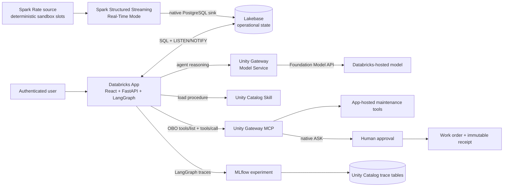

# Asset Reliability Command Centre

> [!IMPORTANT]
> This repository is an archived mirror. The maintained public repository is
> [dan-keeling-databricks/asset-reliability-command-center](https://github.com/dan-keeling-databricks/asset-reliability-command-center).

Asset Reliability Command Centre is a customer-facing Databricks reference demo for detecting
industrial pump risk, investigating it with an autonomous agent, and governing the resulting
maintenance action with a real human approval.

The demo is designed to show how Databricks data, operational serving, application, AI and
governance capabilities work as one system. It is not a production maintenance product or a
claim of measured customer value. All telemetry, incidents and work orders are synthetic.

## What the demo shows

A signed-in user receives a private, live estate of eight pumps. Two normal operating transients
occur once when the sandbox is first created or explicitly reset; the agent reviews them and
correctly takes no action. The user can then trigger a P-204 bearing-degradation excursion and
watch the complete governed response:

1. Spark Real-Time Mode writes live telemetry into the user's isolated Lakebase sandbox.
2. A threshold breach autonomously starts a LangGraph agent hosted in Databricks Apps.
3. The agent reasons through a Unity Gateway Model Service serving a Foundation Model API.
4. It loads a governed Unity Catalog Skill and discovers the available MCP tools at runtime.
5. Unity Gateway applies policy to every tool call and returns native `ASK` before the
   consequential work-order submission.
6. The graph pauses for a real human decision, replays the approved call exactly once, and records
   the resulting work order and immutable governance receipt.
7. MLflow captures the real LangGraph trace, token usage and evaluation evidence.

The App renders only runtime-emitted model, Skill, MCP, policy and tool activity. It does not
fabricate an agent narrative or hard-code a successful tool sequence into the interface.

## Why this demo exists

Process manufacturers and power generators depend on pumps for cooling, lubrication and fluid
movement. A developing bearing fault can become lost production, a forced outage or equipment
damage if it is detected too late. Industry research gives the problem material scale:

- Poor maintenance strategies can reduce productive capacity by **5–20%**, while unplanned
  downtime costs industrial manufacturers an estimated **$50 billion per year**
  ([Deloitte Insights, 2017](https://www2.deloitte.com/us/en/insights/focus/industry-4-0/using-predictive-technologies-for-asset-maintenance.html)).
- Pumps represent **27% of the electricity used by industrial systems in manufacturing**
  ([U.S. Department of Energy, 2006](https://www.energy.gov/sites/prod/files/2014/05/f16/pump.pdf)).

The demo's illustrative site projection assumes 24 critical pumps, eight forced incidents a
year, 7.5 downtime hours per incident and £80,000 of operational impact per hour. A 25% reduction
would recover 15 hours of productive capacity and reduce annual exposure by **£1.2M**. These are
transparent example inputs, not observed prototype results. A customer should replace them with
its asset register, failure history, downtime duration and impact per hour.

The intended outcome is protected availability with less emergency work. A production programme
should measure avoided forced-outage hours, the shift from emergency to planned maintenance,
time from breach to risk decision, energy intensity and agent cost per completed workflow.

## Databricks feature focus

| Databricks capability | Purpose in the demo |
| --- | --- |
| Spark Structured Streaming in Real-Time Mode | Generates and processes continuous telemetry with low latency using one shared stream rather than one query per user. |
| Lakebase | Serves current operational state, personal sandbox controls, incidents, approvals, work orders and audit receipts. |
| Databricks Apps | Hosts the React/FastAPI command centre and LangGraph runtime close to governed data and AI services. |
| Databricks identity and on-behalf-of-user access | Resolves the signed-in user, isolates their sandbox and carries their identity to governed operations. |
| Unity Catalog | Governs the project namespace, streaming checkpoint Volume, agent Skill and durable trace storage. |
| Unity Gateway Model Service | Provides the governed route from LangGraph to the selected Foundation Model API. |
| Unity Gateway MCP and service policy | Discovers tools, enforces source identity and creates the native `ASK` approval boundary before a write. |
| MLflow 3 | Records LangGraph traces, model usage and GenAI evaluation results, with links from the App to the managed experiment. |
| Databricks bundle resources | Defines the App, jobs, compute policy, Lakebase project, experiment and governance resources as parameterised deployment assets. |

The point is not simply to place an LLM beside a dashboard. It is to demonstrate a governed
operating loop in which streaming context, transactional state, agent reasoning, policy,
human authority and long-term evidence remain connected.

## Architecture



One Spark Rate source produces deterministic telemetry slots. Lakebase leases a slot to each
authenticated user's active sandbox and isolates telemetry, commands, incidents, agent state,
approvals and work orders. The App admits concurrent agent runs; one user's investigation does
not create a cross-sandbox queue.

The Rate source is a scalable demo adapter, not the proposed plant ingress. The in-App
Architecture tab deliberately shows Kafka as the production reference: a real deployment can
replace synthetic generation with plant telemetry while retaining the downstream Real-Time Mode,
Lakebase, App and governance pattern. Optional Kafka, Lakeflow Declarative Pipelines and Genie
assets remain in the repository for that reference, but they are inactive and are not required by
the default personal-sandbox installation.

See [Technical architecture](docs/ARCHITECTURE.md) for component responsibilities, concurrency,
identity, recovery and governance details.

## Repository map

| Path | Contents |
| --- | --- |
| `frontend/` | React command centre, incident review, architecture and LangGraph views |
| `backend/` | FastAPI routes, Lakebase repository, LangGraph runtime, MCP tools and MLflow tracing |
| `src/streaming/` | Spark Rate-to-Lakebase Real-Time Mode workload |
| `src/migrations/` and `sql/` | Idempotent operational schema and governed data assets |
| `skills/` | Governed response procedure installed as a Unity Catalog Skill |
| `resources/` | Optional production-reference bundle fragment |
| `scripts/build_app.sh` | DAB artifact build for the runtime-only App source |
| `databricks.yml` | Parameterised Databricks resources |
| `tests/` | Runtime, concurrency, governance and deployment-contract tests |

## Install in a customer workspace

The customer chooses an existing catalog, a new project schema, a serverless SQL warehouse and an
enabled classic node type. DABs derives the remaining names, builds the App and starts the complete
demo.

```bash
git clone https://github.com/dan-keeling-databricks/asset-reliability-command-center.git
cd asset-reliability-command-center
databricks auth login \
  --host "https://<customer-workspace-host>" \
  --profile "<customer-profile>"

export BUNDLE_VAR_catalog="<catalog>"
export BUNDLE_VAR_schema="<new-project-schema>"
export BUNDLE_VAR_warehouse_id="<sql-warehouse-id>"
export BUNDLE_VAR_workload_node_type="<enabled-classic-node-type>"

databricks bundle deploy --target customer --profile "<customer-profile>"
```

See the short [customer installation guide](docs/CUSTOMER_DEPLOYMENT.md) for prerequisites and
how to display the resulting App URL.

## Local development

The local fixture exercises the command-centre interface without Spark, Lakebase, model serving
or Unity Gateway:

```bash
uv sync --locked
npm --prefix frontend ci
./scripts/dev.sh
```

Open `http://127.0.0.1:5173`. `APP_ADAPTER=local` provides deterministic development data. It is
not a substitute for live acceptance of the governed Databricks journey in the target workspace.

## Validation

```bash
uv run ruff check backend tests src scripts
uv run pytest
npm --prefix frontend audit --audit-level=high
npm --prefix frontend run typecheck
npm --prefix frontend run build
databricks bundle validate --strict --target customer --profile <profile>
```

The repository uses manual, reviewed deployment. A merge or Git push never deploys the App or any
other Databricks resource.

## Scope and production considerations

This repository is a reference implementation and demo scaffold. Before adapting it for a
production maintenance process, review the documented
[technical debt and accepted trade-offs](docs/TECHNICAL_DEBT.md), including safety budgets for
agent loops, operational rejection metrics, schema portability, integration testing,
accessibility and component decomposition. Replace synthetic telemetry, example thresholds,
maintenance logic, model choice, policies and value assumptions with customer-owned contracts and
controls.

No customer data, credentials or generated secrets belong in this repository.

## Documentation

- [Business demo flow](DEMO.md)
- [Technical architecture](docs/ARCHITECTURE.md)
- [Customer installation](docs/CUSTOMER_DEPLOYMENT.md)
- [Customer configuration worksheet](docs/examples/customer-values.example.yml)
- [Manual deployment and live acceptance](docs/DEPLOYMENT.md)
- [Technical debt and accepted trade-offs](docs/TECHNICAL_DEBT.md)
- [Current implementation status](TASKS.md)
- [Contribution and branching model](CONTRIBUTING.md)
