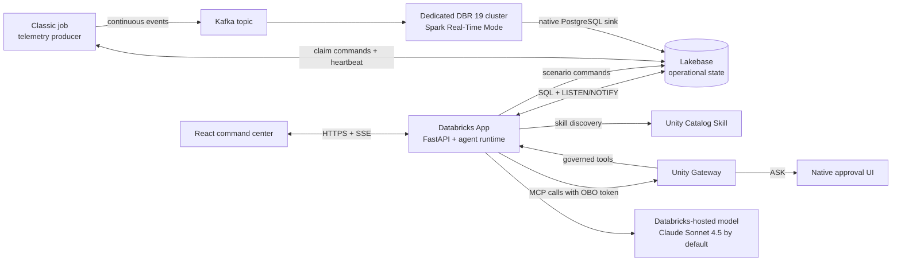

# Technical architecture

## Purpose and design principles

The Asset Reliability Command Center is a ten-minute Energy, Utilities, and Manufacturing
demo. It combines continuous pump telemetry, autonomous anomaly review, and a governed
maintenance action. The command center is the primary experience; alerts invoke agents
without an operator prompt, and the incident overlay renders only activity emitted by the
runtime.

The architecture deliberately separates telemetry production, real-time ingestion,
operational state, application delivery, agent reasoning, and governance. Unity Gateway is
the only approval authority for the work-order write.

## System context

## Deployed components

| Component | Deployment | Responsibility |
| --- | --- | --- |
| Command center | Databricks App `asset-reliability-center` | React UI, FastAPI APIs, SSE, alert evaluator, code-defined agent, App-hosted MCP tools |
| Operational database | Lakebase project `asset-reliability-command-center` | Telemetry log, current state, commands, incidents, runs, activity, identities, work orders |
| Synthetic producer | Continuous job `952037348530266`, isolated classic single-node compute | Eight-pump signal generation, durable command claiming, Kafka publication, heartbeat |
| RTM ingestion | Continuous job `17156207332698`, dedicated DBR 19 classic compute | Kafka decoding and native Lakebase streaming sink |
| Checkpoint storage | `classic_stable_realtime_demos_catalog.asset_reliability_command_center.runtime` | RTM checkpoint and runtime artifacts |
| Governance | UC Skill, HTTP MCP connection, Unity Gateway MCP service, custom policy function | Runtime procedure discovery, tool exposure, `ASK` on `submit_work_order` |
| Model | `databricks-claude-sonnet-4-5` by default | All reasoning, tool selection, and follow-up responses |

The Unity Catalog schema is
`classic_stable_realtime_demos_catalog.asset_reliability_command_center`. Lakebase uses the
PostgreSQL schema `asset_reliability`.

## Telemetry and control flow

1. The producer publishes two samples per second for each of eight comparable pumps. Event
   IDs are deterministic by scenario, sequence, and pump. On restart, the producer resumes
   above both persisted sequence state and the wall-clock sequence floor.
2. Presenter controls write idempotent commands to `scenario_commands`; the App never needs
   network access to Kafka.
3. The producer claims commands with `FOR UPDATE SKIP LOCKED`. `restart_scenario` starts a
   fresh feed with P-202/P-207 transients; `start_p204_excursion` transitions P-204 smoothly
   from its stable signal into issue onset.
4. Standalone Spark Structured Streaming Real-Time Mode reads Kafka and writes the validated
   envelope directly into `telemetry_events` through the native PostgreSQL sink.
5. A Lakebase trigger upserts `pump_live_state` and emits `LISTEN/NOTIFY`. This keeps both the
   current-state read path and UI notification path independent from the event-log size.
6. The App coalesces each notification burst before rebuilding one dashboard snapshot and
   sends revisions over SSE. Alert evaluation remains an independent one-second loop.

Standalone RTM is used because the Lakebase streaming sink is not supported inside public
Lakeflow Declarative Pipelines Real-Time Mode. RTM ingestion owns no alert or agent logic.

## Autonomous agent and governance flow

1. The one-second evaluator detects a threshold entry and transactionally creates one
   incident/run per scenario, pump, and rule.
2. A machine-authored prompt supplies the asset, observed condition, threshold, timestamp,
   incident identifier, and maintenance objective. The presenter does not type it.
3. The runtime loads the governed UC Skill and discovers the current MCP tool surface. Only
   then are skill, server, model, and tool events persisted for the UI.
4. The configured Databricks-hosted model performs every reasoning and tool-selection turn,
   including continuation after a high-risk result. The runtime imposes no tool-call cap or
   fixed visualization stages.
5. Business calls traverse Unity Gateway with the captured user identity. Current tools are
   `get_asset_telemetry`, `assess_failure_risk`, `prepare_work_order`, and
   `submit_work_order`.
6. The custom policy returns native `ASK` for `submit_work_order`. The runtime stores the
   exact serialized request, stops before execution, and exposes the native approval URL.
7. After approval, the runtime replays those exact bytes. Gateway authorization creates the
   work order, and the run completes. A denial or error is recorded rather than represented
   as successful execution.

Independent incidents run in separate asyncio tasks, so normal transients can be evaluated
concurrently. OBO tokens remain in process memory; only identity subjects are persisted.

## Lakebase data model

| Table | Role |
| --- | --- |
| `pumps` | Static fleet and maintenance context |
| `scenario_runs` | One active scenario plus archived run metadata |
| `scenario_commands` | Durable, idempotent presenter commands |
| `telemetry_events` | Append/upsert event log keyed by deterministic `event_id` |
| `pump_live_state` | Latest observation per scenario and pump |
| `alert_rules` | Configured threshold and hysteresis values |
| `incidents` | Alert lifecycle and business resolution |
| `agent_runs` | Agent status, approval request, token/cost/tool totals |
| `activity_events` | Ordered runtime-emitted timeline |
| `conversation_messages` | Agent/operator follow-up conversation |
| `work_orders` | Governed maintenance result |
| `run_identities` | Persisted user subject audit metadata, never tokens |
| `component_heartbeats` | Producer health and acknowledged message count |

Uniqueness constraints prevent duplicate active scenarios, commands, incidents, events, and
work orders. Database notifications are hints; canonical state always comes from tables.

## Bounded read and retention design

Dashboard latency is measured from immediately before acquiring a Lakebase connection until
the complete snapshot query set returns. Sparkline reads use eight index-backed lateral
probes over `(scenario_id, pump_id, event_time DESC)`, each limited to 20 samples. Query cost
therefore remains bounded as `telemetry_events` grows.

Agent telemetry tools query the active scenario directly and never construct a dashboard
snapshot. SSE waits for a real change, coalesces row-level notification bursts for 50 ms,
and then queries once.

Raw telemetry retention is 24 hours. Every five minutes the App performs best-effort cleanup
in batches of at most 1,000 events per scenario/pump. Deletes use the same composite index,
`FOR UPDATE SKIP LOCKED`, a 250 ms lock timeout, and a two-second statement timeout. Cleanup
enumerates only the small scenario/pump cross product; it never scans the event log to
discover work. Cleanup failure is isolated from ingestion and interactive reads.

## Failure and recovery behavior

- Kafka publication is acknowledged before the producer heartbeat advances. Broker failure
  makes the continuous job fail visibly and restart.
- Producer sequence recovery prevents event-ID collisions after job replacement.
- RTM uses a persistent UC checkpoint and idempotent event keys.
- Alert creation and command claiming are transactionally deduplicated.
- A transient evaluator/database error is retried on the next one-second pass.
- Pending approval persists in Lakebase, while replay still requires the in-memory OBO token;
  restarting the App during approval requires reopening the scenario under a live user session.
- SSE reconnects using revisions and always rebuilds state from Lakebase rather than treating
  notifications as durable events.

## Security and governance boundaries

- The Databricks App service principal owns the Lakebase schema and receives only declared
  App resources.
- The browser's forwarded user token is captured server-side for Gateway calls and is never
  written to Lakebase or logs.
- The root HTTP connection uses the App service principal only to reach the MCP endpoint;
  Gateway policies govern business execution.
- Model, Skill, MCP, and Gateway access are Databricks-native resource bindings.
- Generated connection credentials and OAuth secrets are created through APIs and never
  stored in this repository.

## Source layout

| Path | Contents |
| --- | --- |
| `frontend/` | React/Vite command center |
| `backend/` | FastAPI service, Lakebase repository, agent runtime, Gateway/model clients, MCP tools |
| `src/producer/` | Continuous synthetic telemetry publisher |
| `src/streaming/` | Standalone Spark RTM Kafka-to-Lakebase query |
| `skills/` | Governed UC Skill source |
| `sql/` | Idempotent Lakebase schema and Gateway policy function |
| `scripts/` | Local development and governance deployment helpers |
| `tests/` | API, Gateway, repository, concurrency, and query-shape tests |
| `databricks.yml` | Databricks Asset Bundle resources |
| `app.yaml` | Production App command and environment |

See `docs/DEPLOYMENT.md` for the manual deployment and validation process.
