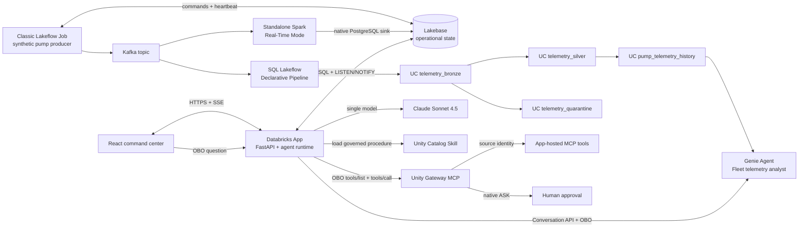

# Technical architecture

## Scope and design principles

The Asset Reliability Command Center is an end-to-end process-manufacturing prototype. It
combines continuous synthetic pump telemetry, low-latency operational serving, governed
historical analytics, autonomous incident response, and a real human-approval boundary.

The primary experience is the live command center. Alerts launch agents automatically; the
presenter never types the initiating prompt. The UI renders model, Skill, MCP, policy, and tool
activity only after the runtime emits it. Unity Gateway—not application code—is the approval
authority for the maintenance write.

## End-to-end topology

## Data journey

### 1. Synthetic source and control plane

The producer continuously publishes two observations per second for each of eight comparable
pumps. Stable baselines, two normal transients, and the presenter-controlled P-204 degradation
are generated as a continuous signal; triggering P-204 does not replace or interrupt its feed.

The App never needs network access to Kafka. Presenter controls create durable Lakebase
`scenario_commands`. The producer claims pending or expired commands with versioned leases,
bounded retries, and owner-checked completion. Kafka acknowledgement precedes producer heartbeat
advancement, and deterministic event identifiers make downstream retries idempotent.

### 2. Operational path: Real-Time Mode to Lakebase

The standalone Spark Structured Streaming job runs in Real-Time Mode on dedicated classic
compute. It decodes Kafka envelopes and uses the native PostgreSQL sink to write Lakebase
`telemetry_events`. A trigger maintains `pump_live_state` and publishes `LISTEN/NOTIFY` hints.

The App reads bounded current-state and per-pump top-N queries, coalesces database notification
bursts, and pushes canonical snapshots over SSE. An independent one-second evaluator queries
Lakebase and creates an incident exactly once when an alert rule enters its trigger state.

Standalone RTM remains separate because the native Lakebase streaming sink is not supported
inside the public Lakeflow Declarative Pipelines Real-Time Mode surface.

### 3. Governed history: SQL Lakeflow Declarative Pipeline

The same Kafka topic is consumed independently by a continuous, classic-compute SQL Lakeflow
Declarative Pipeline:

| Dataset | Contract | Access |
| --- | --- | --- |
| `telemetry_bronze` | Raw UTF-8 payload plus Kafka topic, partition, offset, and timestamps | Pipeline operators only |
| `telemetry_silver` | Typed telemetry with physical-sanity expectations and internal provenance | Pipeline operators only |
| `telemetry_quarantine` | Invalid payload, broker provenance, and explicit rejection reasons | Pipeline operators only |
| `pump_telemetry_history` | Continuous validated measurements without scenario/control fields | Existing App access group |

Silver retains internal scenario and Kafka coordinates for engineering support. The curated view
deliberately omits them. Genie therefore sees one chronological fleet history that persists
across command-center restarts and does not understand incidents, agent executions, work orders,
or demo scenarios.

Unity Catalog supplies ownership, three-part naming, comments, lineage, and permissions. The
existing `asset-reliability-command-center-operator` group receives `USE CATALOG`, `USE SCHEMA`,
and `SELECT` only on the curated view; no additional read-only group is created.

The producer, standalone RTM job, and continuous pipeline-runner job execute as the existing App
service principal. A bundle-managed least-privilege compute policy limits them to the approved
classic `i3.xlarge` shapes, worker counts, runtimes, and on-demand availability. The producer and
RTM resources explicitly require `SINGLE_USER`; the policy intentionally omits access mode because
Lakeflow Declarative Pipelines reject policies that define it. A deployer-run,
idempotent grant job gives that identity only the UC schema creation and runtime-volume access
needed by those workloads before their run-as identity is changed. Because their notebooks are
synced below the human deployer's bundle directory, the deployment helper also derives that
directory from bundle metadata and grants the same service principal `CAN_READ` before any job or
pipeline restart; this is a workspace-object permission, distinct from Unity Catalog privileges.

## Databricks App and two distinct AI experiences

### Autonomous reliability agent

The alert evaluator creates a machine-authored prompt containing the pump, observed threshold
condition, timestamp, incident identifier, and maintenance objective. A background task per
incident permits concurrent evaluations.

The code-defined loop uses one model—`databricks-claude-sonnet-4-5`—for action selection,
reasoning, and final response. It loads the governed UC Skill, calls `tools/list` on the single
configured MCP service, and lets the model choose tools without a UI-imposed stage or call cap.
The current discovered tools are:

- `get_asset_telemetry`
- `assess_failure_risk`
- `prepare_work_order`
- `submit_work_order`

Every model or tool activity is persisted and rendered separately. The model reports tokens and
estimated cost for one attributable model, supporting future cross-model benchmark work.

### Fleet telemetry analyst

The Fleet telemetry analyst is a separate Genie Agent embedded in a right-hand App drawer. It is
limited to `pump_telemetry_history`. Questions and follow-ups go through a focused FastAPI adapter
to the Genie Conversation API using the current user's forwarded OBO token.

The drawer shows execution identity, intermediate status, natural-language answers, bounded
tabular results, generated SQL, source/freshness, and an AI-generated-answer disclaimer. It also
handles empty, ambiguous, partial, and error states. Conversation identifiers are held in a
bounded per-user in-memory registry and are not tied to command-center scenarios or resets.

## Governance and identity boundaries

The App-to-Gateway hop uses the current operator's OBO token. Gateway evaluates that user's tool
access and policy. The Gateway-to-source hop is different: the configured HTTP connection uses
the App service principal, and `/mcp` rejects human callers that try to bypass Gateway.

The custom `submit_work_order` policy returns native `ASK`. The agent persists the exact pending
request and stops before source execution. Approval replay is single-flight: an atomic lease
allows only one caller to resume the request. A successful replay creates an immutable governance
receipt containing the elicitation identifier, request hash, approving subject, decision, and
timestamps. Denial, repeated `ASK`, and transport errors cannot be represented as success.

The deployment helper reconciles the Skill, MCP source connection, selected tools, service
policy, and App-source permission. Its probe first requires exact tool discovery and a benign
source read, then must receive `ASK` with `execution=not executed` before governance deployment is
considered valid.

OBO access tokens live only in process memory and are never logged or persisted. Identity subjects
are retained for audit. Restart and operator handover cancel and await local tasks, while active
scenario/run predicates and UUID/version approval claims fence delayed work from other replicas
before any state transition or governed completion.

## Lakebase operational model

| Table | Purpose |
| --- | --- |
| `pumps`, `alert_rules` | Fleet metadata and threshold/hysteresis rules |
| `scenario_runs`, `scenario_commands` | Demo lifecycle and recoverable producer commands |
| `telemetry_events`, `pump_live_state` | Operational event log and bounded latest state |
| `incidents`, `agent_runs` | Alert and autonomous-execution lifecycle |
| `activity_events`, `conversation_messages` | Ordered runtime activity and operator follow-ups |
| `work_orders`, `governance_receipts` | Governed outcome and immutable approval evidence |
| `run_identities`, `app_users`, `shift_operator`, `shift_operator_audit` | OBO subject and shared-operator audit |
| `component_heartbeats` | Producer and evaluator freshness signals |

Run and incident rows act as sequence-allocation locks for concurrent timeline writers. Database
uniqueness constraints remain the final idempotency guard for scenarios, commands, events,
incidents, and work orders.

## Health, recovery, and retention

The top-right App status is derived from Lakebase reachability, latest ingested telemetry,
producer heartbeat, RTM's durable effect, and evaluator heartbeat. A stale signal changes the
state to degraded and identifies the affected component.

Operational telemetry is retained for 24 hours. Batched, index-backed cleanup is best effort and
cannot block ingestion. Unity Catalog history is independent and is not cleared by App restart.

The generated root `.build-info.json` records the clean Git commit included in a deployment; the
App exposes it through `/api/build-info`. Deployment stages this file with only the App's runtime
Python, compiled frontend, Lakebase migration, and dependency manifests under `.artifacts/app`.
The App snapshot is rooted there so managed Genie workspace nodes and non-runtime bundle assets
cannot enter the snapshot. Deployment is repository-first and manual through `scripts/deploy.py`.

## Repository map

| Path | Contents |
| --- | --- |
| `frontend/` | React command center and Genie drawer |
| `backend/` | FastAPI, Lakebase repository, autonomous runtime, Genie adapter, MCP tools |
| `src/producer/` | Continuous synthetic telemetry producer notebook source |
| `src/streaming/` | Standalone Spark RTM Kafka-to-Lakebase notebook source |
| `src/pipelines/` | Documented SQL Lakeflow governed-history pipeline |
| `genie/` | Reproducible serialized Genie Agent definition |
| `skills/` | Governed UC Skill source |
| `sql/` | Lakebase schema, view grants, and Gateway policy function |
| `scripts/` | Checked deployment and idempotent data/governance helpers |
| `tests/` | API, runtime, governance, data-plane, concurrency, and deployment contracts |
| `docs/` | Architecture, deployment, evidence, and technical-debt records |
| `.artifacts/app/` | Ignored, reproducibly generated runtime-only App snapshot source |
